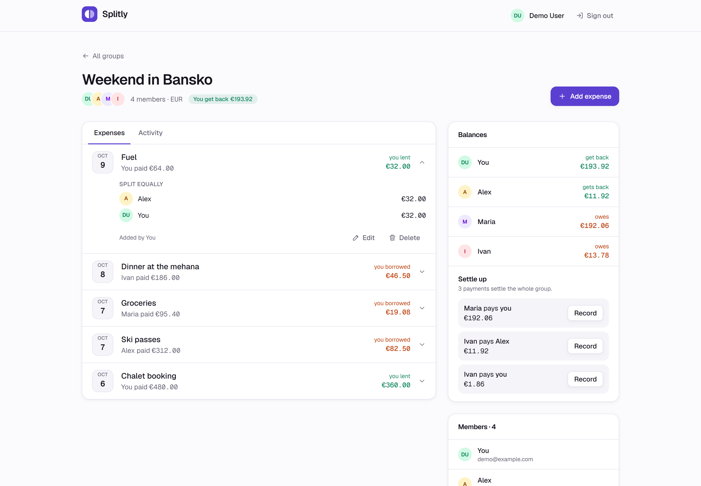
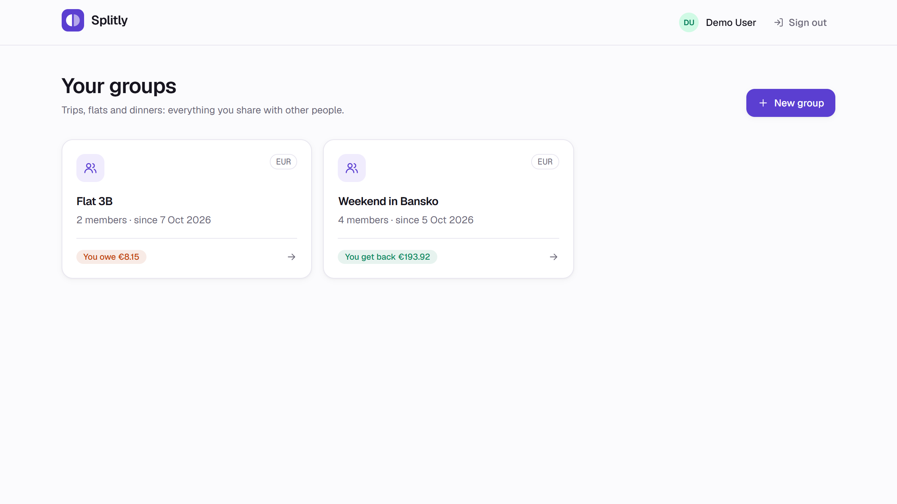
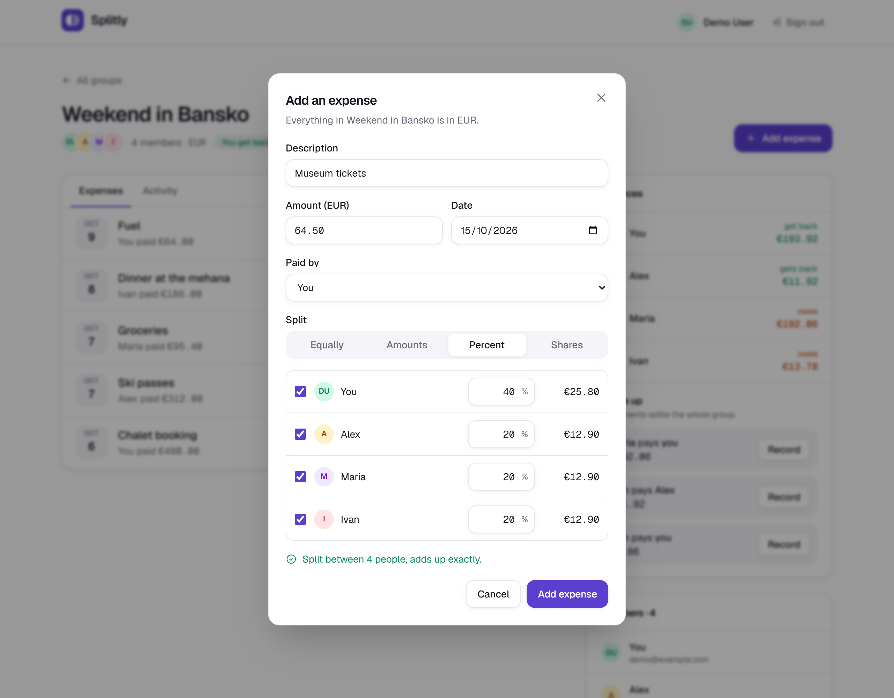
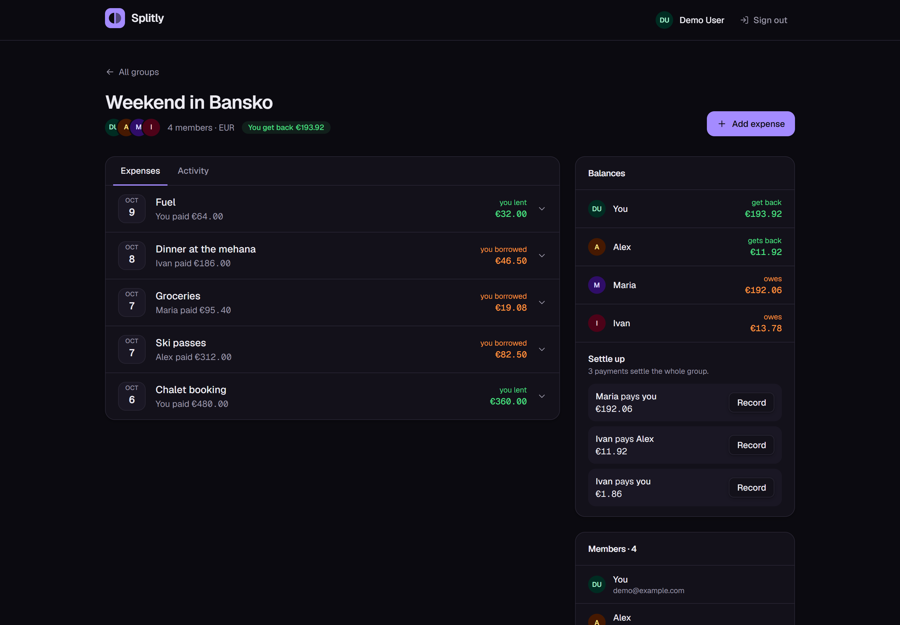
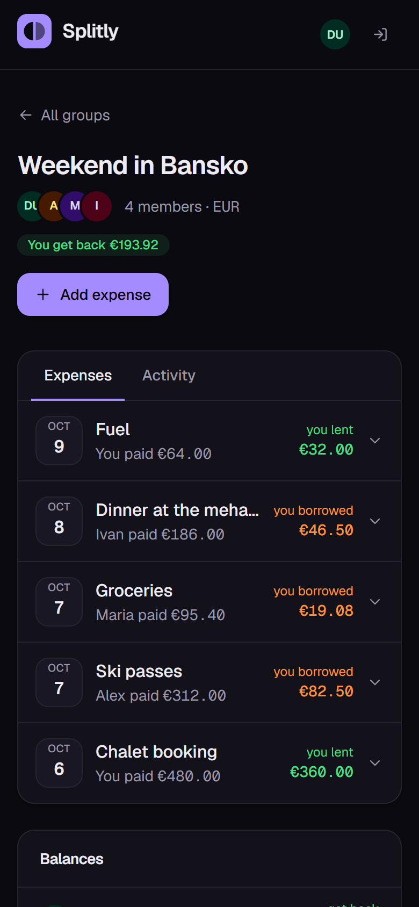
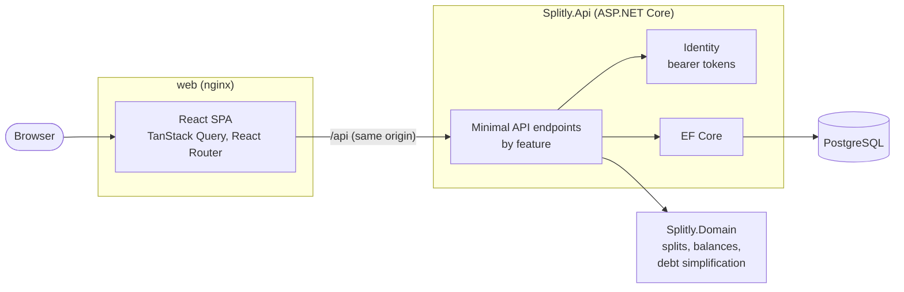

<div align="center">


# Splitly

**Split shared expenses with friends and settle up in as few payments as possible.**

[](https://github.com/nataliboeva/splitly/actions/workflows/ci.yml)


[](LICENSE)

</div>



Splitly is a full-stack expense splitting app in the spirit of Splitwise: create a group for a trip
or a flat, add what everyone paid, and it tells you who owes whom. The interesting part is the money
logic: every split adds up to the exact cent, and the settle-up suggestions keep the number of
payments small.

## Screenshots

| Your groups | Adding an expense |
| --- | --- |
|  |  |

| Dark mode | Mobile |
| --- | --- |
|  |  |

The screenshots were taken from the Docker setup below with the seeded demo data. To refresh them,
run `docker compose up --build`, sign in as the demo user and capture the pages at 2x scale into
`docs/screenshots/` with the same file names.

## Features

- **Accounts**: register and sign in with ASP.NET Core Identity bearer tokens; the client refreshes
  expired tokens transparently.
- **Groups**: create a group with a currency (EUR by default), add people by the email of their
  Splitly account, see your balance in every group at a glance. Only members can see or change a group.
- **Expenses** with four split methods:
  - **Equally** between everyone selected,
  - **Exact amounts** per person,
  - **Percentages** (up to two decimals, must add up to 100%),
  - **Shares** (e.g. 2 shares for a couple, 1.5 for someone who joined late).
- **Exact rounding**: €100 split three ways is €33.34 + €33.33 + €33.33, never €99.99. The form
  previews the split live, with the same algorithm as the server.
- **Balances and settle-up**: each member's net balance plus suggested payments that settle the
  whole group, which you can record with one click.
- **Activity feed** per group: who added, edited or deleted what, and who paid whom.
- **Edit and delete** expenses (only the person who added one can change it).
- **Polished UI**: light and dark theme following the system, responsive down to 375px, keyboard
  friendly with visible focus styles, loading skeletons and empty states.
- **Demo data** seeded in Development, so there is something to look at straight away.

## Architecture



- **Splitly.Domain** is a plain class library with no dependencies. It holds the entities (groups,
  expenses, settlements, activity) and the money logic: the split calculator, the
  largest-remainder allocator, balances and debt simplification.
- **Splitly.Api** is the ASP.NET Core host: Minimal API endpoints grouped by feature
  (`Features/Groups`, `Features/Expenses`, ...), EF Core with PostgreSQL, Identity, FluentValidation,
  ProblemDetails, OpenAPI with Scalar, health checks and Serilog.
- **web** is a React single-page app. In Docker it is served by nginx, which also proxies `/api` to
  the API; in development Vite does the same proxying.

### API overview

| Method | Route | Description |
| --- | --- | --- |
| `POST` | `/api/auth/register`, `/api/auth/login`, `/api/auth/refresh` | ASP.NET Core Identity endpoints |
| `GET` `PUT` | `/api/users/me` | Your profile (display name) |
| `GET` | `/api/currencies` | Supported currencies |
| `GET` `POST` | `/api/groups` | Your groups with your balance in each, create a group |
| `GET` | `/api/groups/{id}` | Group details and members |
| `POST` | `/api/groups/{id}/members` | Add a member by email |
| `GET` `POST` | `/api/groups/{id}/expenses` | List or add expenses |
| `GET` `PUT` `DELETE` | `/api/groups/{id}/expenses/{expenseId}` | Read, edit or delete an expense |
| `GET` | `/api/groups/{id}/balances` | Net balances and suggested transfers |
| `POST` | `/api/groups/{id}/settlements` | Record a payment between two members |
| `GET` | `/api/groups/{id}/activity` | Activity feed, newest first |
| `GET` | `/health` | Health check including the database |

Interactive documentation is available at `/scalar` when the API runs in Development.

## Tech stack

| Area | Technologies |
| --- | --- |
| Backend | .NET 10, ASP.NET Core Minimal APIs, EF Core 10 + Npgsql, ASP.NET Core Identity, FluentValidation, Microsoft.AspNetCore.OpenApi + Scalar, Serilog |
| Frontend | React 19, TypeScript, Vite, TanStack Query, React Router, react-hook-form + zod, Tailwind CSS v4 |
| Database | PostgreSQL 18 |
| Testing | xUnit v3, Shouldly, CsCheck (property-based), WebApplicationFactory + Testcontainers, Vitest + Testing Library |
| Tooling | Central package management, ESLint, Prettier, Docker Compose, GitHub Actions |

## Getting started

### Run everything with Docker

Prerequisites: [Docker](https://docs.docker.com/get-docker/) with Docker Compose.

```bash
git clone https://github.com/nataliboeva/splitly.git
cd splitly
docker compose up --build
```

Then open:

- **App**: http://localhost:8080
- **API docs (Scalar)**: http://localhost:5080/scalar

The API runs in the Development environment in this setup, so it applies the database migrations
and seeds the demo data on startup.

### Demo accounts

| Email | Password |
| --- | --- |
| `demo@example.com` | `Demo123!` |
| `alex@example.com`, `maria@example.com`, `ivan@example.com` | `Demo123!` |

The demo user has two groups, "Weekend in Bansko" (every split method plus a recorded payment) and
"Flat 3B".

### Run locally for development

Prerequisites: [.NET 10 SDK](https://dotnet.microsoft.com/download), [Node.js 24+](https://nodejs.org/),
[pnpm 10](https://pnpm.io/installation) and Docker for the database.

```bash
# 1. Start PostgreSQL
docker compose up -d db

# 2. Start the API on http://localhost:5080 (applies migrations and seeds demo data)
dotnet run --project src/Splitly.Api

# 3. In a second terminal, start the web app on http://localhost:5173
cd web
pnpm install
pnpm dev
```

Database migrations live in `src/Splitly.Api/Data/Migrations`. To add one:

```bash
dotnet tool restore
dotnet ef migrations add <Name> --project src/Splitly.Api --output-dir Data/Migrations
```

## Running tests

```bash
# Backend: domain unit and property-based tests + API integration tests
dotnet test

# Frontend
cd web
pnpm test        # Vitest + Testing Library
pnpm lint        # ESLint
pnpm typecheck   # TypeScript
```

- **Splitly.Domain.Tests** (80 tests) cover splitting, rounding, balances and debt simplification.
  CsCheck generates thousands of random expenses and checks that every split adds up to the
  amount, that each share is within one cent of its exact value, and that following the settle-up
  suggestions brings every balance to zero.
- **Splitly.Api.Tests** (32 tests) run the real API in memory against PostgreSQL in a Testcontainers
  container: authentication, membership rules, validation, every endpoint and the demo seeder.
  They need Docker; without it they are skipped with a message saying why.
- **web** (35 tests) covers the split preview, money parsing, the API client's token refresh,
  the login page and the expense form.

## Project structure

```text
splitly/
├── src/
│   ├── Splitly.Domain/          # Entities and money logic, no dependencies
│   │   ├── Splits/              # SplitCalculator, Allocator (largest remainder)
│   │   ├── Balances/            # BalanceCalculator, DebtSimplifier
│   │   └── Groups/, Expenses/, Settlements/, Activity/
│   └── Splitly.Api/             # ASP.NET Core host
│       ├── Features/            # Endpoints, contracts and validators per feature
│       ├── Common/              # Validation and membership filters, ProblemDetails helpers
│       └── Data/                # DbContext, entity configurations, migrations, demo seeder
├── tests/
│   ├── Splitly.Domain.Tests/    # xUnit + CsCheck
│   └── Splitly.Api.Tests/       # WebApplicationFactory + Testcontainers
├── web/                         # React + TypeScript + Vite
│   └── src/
│       ├── api/                 # Typed client, TanStack Query hooks
│       ├── auth/                # Session handling and route guards
│       ├── components/          # Layout and UI primitives
│       ├── features/            # Groups, expenses, balances, activity
│       ├── lib/                 # Money, dates, split preview
│       └── pages/
├── docs/screenshots/
├── docker-compose.yml
└── .github/workflows/ci.yml
```

## Design decisions

- **Money is split in whole cents with integer arithmetic.** Amounts are converted to minor units
  (cents, or whole yen for JPY), split with the largest remainder method, and converted back. Every
  part is rounded down first, then the leftover cents go to the largest remainders, with ties going
  to whoever is listed first. That makes splits exact and deterministic without any floating point.
- **The domain project has no dependencies**, so the core logic is easy to test in isolation.
  Entities guard their own rules (only members can take part in an expense, only its creator can
  edit it) and validate before changing state.
- **Expected failures are results, not exceptions.** "Percentages must add up to 100%" comes back as
  a `Result` and becomes a 400 ProblemDetails with a readable message. FluentValidation handles the
  shape of requests; the domain handles rules that need the group, such as membership or currency
  precision.
- **Debt simplification is greedy.** The biggest debtor pays the biggest creditor until everyone is
  even. This needs at most n - 1 payments for n people. It doesn't always find the absolute
  minimum (that problem is NP-hard), but it is simple, fast and predictable; property tests check
  that the suggestions always settle the group within that bound.
- **Balances are computed from the full history on each request** instead of being stored. They
  can never drift out of sync with the expenses, at the cost of reading every expense in the
  group. That is fine at this scale; caching or snapshots would come first if groups got large.
- **Membership is enforced by an endpoint filter on route groups.** Everything under
  `/api/groups/{groupId}` goes through the same check, so a new endpoint can't forget it.
  Outsiders get a 404 rather than a 403, so they can't tell which group ids exist.
- **Activity entries store a message snapshot**, so the feed still makes sense after the expense it
  mentions has been edited or deleted.
- **Auth uses Identity's built-in bearer tokens (`MapIdentityApi`)** rather than hand-rolled JWTs.
  The register endpoint only accepts email and password, so the display name is saved through
  `/api/users/me` right after. Tokens are kept in `localStorage`, which is simple but readable by
  any script on the page; httpOnly cookies would be the next step for a production app.
- **One origin, no CORS.** nginx (and Vite in development) proxies `/api` to the API, so the
  browser only ever talks to a single origin.
- **Integration tests use real PostgreSQL** through Testcontainers instead of the EF Core in-memory
  provider, so constraints, migrations and queries behave exactly as in production.

## Roadmap

- Invite people who don't have an account yet
- Remove members and leave groups once everything is settled
- Edit and delete recorded payments
- Groups with several currencies and exchange rates
- Optimistic concurrency for simultaneous expense edits
- Pagination for long expense lists
- Persist Data Protection keys so restarting the API container keeps people signed in
- httpOnly cookie authentication instead of tokens in `localStorage`
- End-to-end tests with Playwright

## License

[MIT](LICENSE) © 2026 Natali Boeva
